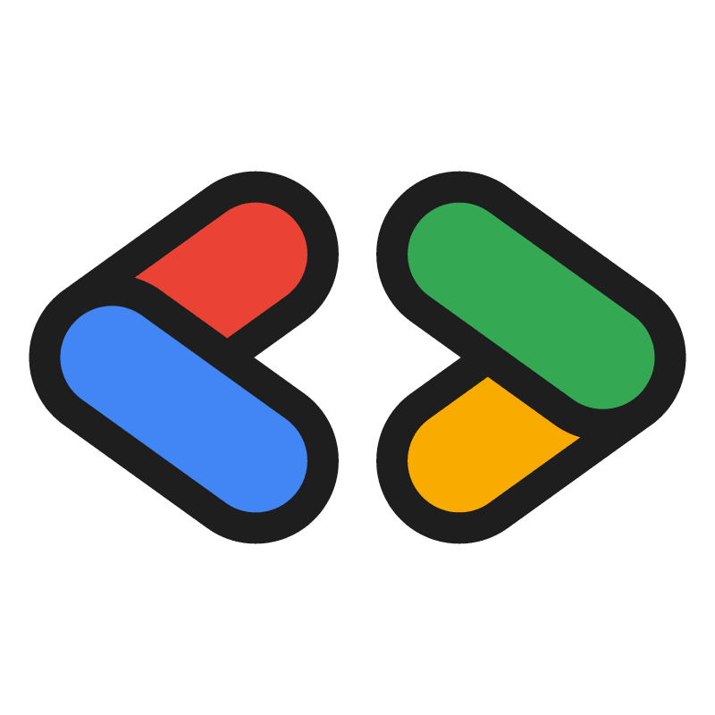

<h1 align="center">Google Developer Groups On Campus</h1>
<h3 align="center">Universitas Widyatama &bull; Bandung, Indonesia</h3>

  <em>Connect, Learn, and Grow with Google Developer Technologies.</em>

  

  
  
  

> [!NOTE]
> **Selamat datang di Organisasi Resmi GDGoC Universitas Widyatama!**  
> Kami adalah komunitas pengembang berbasis kampus yang didukung langsung oleh **Google Developers**. Wadah ini hadir untuk mempertemukan mahasiswa yang memiliki minat dan antusiasme di bidang teknologi, pemrograman, dan inovasi digital.

---

## Tentang Kami

**Google Developer Groups On Campus (GDGoC) Universitas Widyatama** adalah ruang belajar, bertumbuh, dan berkolaborasi bagi seluruh mahasiswa Universitas Widyatama yang tertarik mendalami dunia teknologi dan rekayasa perangkat lunak modern.

Kami percaya bahwa proses belajar paling efektif terjadi ketika kita saling berbagi dan mempraktikkannya langsung. Melalui rangkaian workshop teknis, sesi berbagi (*tech talk*), study jam, hingga proyek kolaborasi terbuka, kami mendampingi mahasiswa dari pemula hingga mampu menciptakan karya nyata yang bermanfaat.

---

  &copy; 2026 <strong>Google Developer Groups On Campus Universitas Widyatama</strong> &bull; Bandung, Jawa Barat, Indonesia. Dikelola oleh Core Team GDGoC Widyatama.

